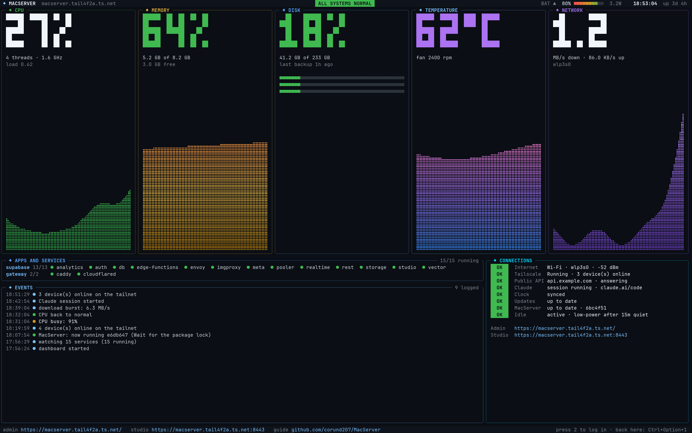

# MacServer: the step-by-step guide

This guide takes you from a 2019 MacBook Air to a private server that runs the
backend (database, sign-in, file storage) for your apps. You don't need to know
Linux. Follow the parts in order; each one says what you will see.

It takes about an hour, most of it waiting.

1. [What you need](#1-what-you-need)
2. [Set up Tailscale](#2-set-up-tailscale-5-minutes)
3. [Make the USB stick](#3-make-the-usb-stick)
4. [Let the Mac start from USB](#4-let-the-mac-start-from-usb-once)
5. [Install](#5-install-about-20-minutes)
6. [First start](#6-first-start-about-15-minutes)
7. [Open your admin page](#7-open-your-admin-page)
8. [Connect an app](#8-connect-an-app)
9. [Get help from Claude](#9-get-help-from-claude)
10. [Everyday use](#10-everyday-use)
11. [Updates to MacServer itself](#11-updates-to-macserver-itself)
12. [If something goes wrong](#12-if-something-goes-wrong)

---

## 1. What you need

- The **2019 MacBook Air** and its charger. Everything on it will be erased.
- A **USB stick** of 4 GB or more (plus a USB-C adapter if the stick is USB-A).
  It will be erased too.
- A **Windows PC** to make the USB stick.
- **Wi-Fi** (the name and password). A USB-C Ethernet adapter also works.
- A free **[Tailscale](https://tailscale.com)** account. It's how you reach the
  server privately from your phone and computer.
- Optional, for apps used by other people on the Internet: a domain on
  **Cloudflare** (free plan). You can add this later.
- Optional, for AI help on the server: a **claude.ai** plan (Pro or Max).

## 2. Set up Tailscale (5 minutes)

Tailscale makes a private network between your own devices. The server is only
reachable through it: nobody else on the Internet or your home Wi-Fi can reach it.

1. Sign up at [tailscale.com](https://tailscale.com).
2. Install the Tailscale app on your **phone** and your **computer**, and sign in
   with the same account.
3. Open the [DNS settings](https://login.tailscale.com/admin/dns) and turn on
   **MagicDNS** and **HTTPS Certificates**. (The admin page needs both.)

## 3. Make the USB stick

The stick holds the MacServer installer. Yours is a **personal** copy: it includes
Apple's Wi-Fi driver files for your Mac, so Wi-Fi works from the first screen.
Apple doesn't allow sharing those files, so never give this image to anyone.

**Once:** install WSL (Linux inside Windows). Open PowerShell and run:

```powershell
wsl --install -d Debian
```

Restart Windows when it asks, and pick a Linux username and password when the
Debian window opens.

**Build the image.** Get the MacServer folder (Code → Download ZIP on
[GitHub](https://github.com/corund207/MacServer), or `git clone`), open PowerShell
**in that folder**, and run:

```powershell
powershell -ExecutionPolicy Bypass -File iso\make-personal-usb.ps1
```

The first run takes about 20 minutes (it downloads the Wi-Fi files from Apple and
builds the system); later runs take about a minute. It ends with
`Done: ...\Downloads\macserver-personal-wifi.iso`.

**Write it to the stick.** Install [balenaEtcher](https://etcher.balena.io), choose
**Flash from file** → `macserver-personal-wifi.iso`, select your USB stick, and
**Flash**.

## 4. Let the Mac start from USB (once)

Macs with a T2 chip only start macOS unless you allow otherwise.

1. Turn the Mac on while holding **⌘ Command + R** (if macOS is already erased,
   hold **⌥ Option + ⌘ Command + R** to load it from the Internet).
2. Choose **Utilities → Startup Security Utility**. Enter the Mac's password if asked.
3. Set **Secure Boot: No Security** and **Allow booting from external or removable
   media**.
4. Shut the Mac down.

## 5. Install (about 20 minutes)

1. Plug in the charger and the USB stick. Turn the Mac on while holding
   **⌥ Option**, and choose the orange **EFI Boot** disk.
2. The MacServer installer starts. You'll see "Wi-Fi firmware loaded from the USB
   stick", then the Wi-Fi list:
   - Choose your network with the arrow keys and press Enter, then type the password.
   - When **Deactivate** appears next to your network, you're connected. Choose
     **Quit**.
3. The installer checks the Internet and **sets the clock** by itself (a Mac with
   a flat battery often has the wrong date, which breaks secure downloads). If it
   still says "not connected", read the reason it shows. If it mentions the clock
   or a certificate, choose **Set the date and time by hand**.
4. Answer the questions:
   - **Server name**: e.g. `macserver`. Your addresses will use it.
   - **Username and password**: for logging in to the server and for `sudo`.
   - **Encrypt the disk**: yes. Pick a passphrase you won't forget: you type it
     every time the Mac starts, and without it the data is gone.
   - **Time zone**, **built-in Wi-Fi** (keep it on), **Tailscale auth key** (just
     press Enter to skip; you'll scan a QR code instead).
5. Type **ERASE** to confirm. The installer erases the Mac's disk and installs
   everything. Leave it alone until it says **MacServer is installed**.
6. Remove the USB stick and press Enter. The Mac restarts.

## 6. First start (about 15 minutes)

1. The Mac asks for the **disk passphrase**. Type it on the Mac's keyboard and
   press Enter. (Nothing appears while you type. That's normal.)
2. Setup continues by itself: security updates, firewall, Docker, Supabase.
3. A **QR code** appears. Scan it with your phone's camera and sign in to
   Tailscale. This adds the server to your private network.
4. When setup is done, the screen switches to the **MacServer dashboard**:



The dashboard stays on screen all the time and never goes dark. It is one page on a black
background with a fixed place for everything; nothing turns by itself and there are no keys
to learn. Colour carries meaning: green is good, amber a notice, red broken, and each metric
has its own hue. The top bar shows the server's name, an overall status (green = all good),
the battery, the time and uptime. Below it, from top to bottom:

- **Needs attention** (only when something is wrong): each issue with why, and the first
  thing to run. `macserver issues` has the full details and every fix.
- **CPU, memory, disk, network, thermal**: the reading, a meter, the last 20 minutes as a
  graph, and the key figures (load, available memory, reads and writes, when the last
  backup was made, Wi-Fi signal, fan, battery).
- **Services**: every container grouped by app, with its state, CPU, memory and uptime
  (and restarts and traffic when there is room). A stopped one is red and comes first.
- **Devices**: every device on your tailnet (name, Tailscale address, system, whether it
  connects directly or through a relay, last seen, traffic), and every device the Mac has
  talked to on its own network lately (address and hardware address; the router is marked,
  and "private MAC" means a phone or laptop using a randomised address).
- **Connections**: Internet, Tailscale, the public API, Claude, clock, updates, each with
  an **OK / WARN / DOWN / OFF / INFO** tag, the admin and Studio addresses, and the **Events** log.
  Two rows are about updates, and they are different things: **MacServer** is this project's
  own software, which updates itself from GitHub; **Debian** counts the system's packages
  waiting. Security fixes install by themselves each morning; the rest (Docker, for example)
  wait for `sudo macserver update`. Packages waiting are shown as INFO, not as a problem.

**Heat is not a warning.** A MacBook Air under load runs in the 90s and touches the CPU's
own 100 °C limit many times a minute with the fans at full speed; that is how it works.
So no temperature turns the screen amber or adds a notice. The one cooling alarm is a
fault: a CPU at 85 °C or more whose fan is not turning.

**Text size.** The default fits about 230 x 64 characters on the Mac's screen. To
change it, add `DASHBOARD_FONT_PX=16` (smaller, more detail) or `22` (bigger) to
`/etc/macserver/macserver.conf`, then run `sudo ./install.sh --redo host` from the
MacServer folder and log out of the Mac's screen.

**Alerts.** When something needs attention, the edge of the screen **pulses orange**.
When something is broken (a service stopped, Tailscale or the network down, the public
API not answering), the edge **flashes red** and the status turns red, with the
problems at the top and up to three numbered commands for each. For the facts, logs and
files to open, log in (press **2**) and run `macserver issues`.

The screen returns to normal by itself once everything works again.

**Phone alerts.** The Mac can push an alert to your phone when the screen shows an issue,
with a one-line summary; tapping it opens your admin page (over Tailscale, so keep the
Tailscale app on). It alerts on what the screen calls an issue and nothing else: never heat,
and never the notices the screen itself mutes.

- A **critical** issue (a service stopped, the public API down, Tailscale or the Internet
  gone) is sent after it lasts a minute, at urgent priority, and again every 4 hours while it
  stays open.
- Any other issue is sent once, after three minutes, and not within 15 minutes of the last
  alert. One alert lists everything that is open, worst first.
- At most 4 alerts an hour and 12 a day. An alert that could not be sent is retried every
  5 minutes.
- **Every hour**, on the hour, a quiet status report: one line with the state and the key
  numbers (CPU, memory, disk, temperature, services, devices online, last backup, uptime),
  for example `MacServer: All systems normal | CPU 12% | mem 64% | disk 18% | 77C | 27/27
  services | 2 device(s) online | backup 1h ago | up 3d`. It is sent at low priority, so it
  does not buzz like an alert, and it never counts against the alert limits. Send one now
  with `sudo macserver notify report`; turn them off or on with
  `sudo macserver notify report off` / `on`.

The alert goes out through GitHub and the free **ntfy** push service, so nothing about your
phone is stored on the Mac. (It used to be a text through your carrier's email-to-text
gateway; Verizon shut that down.) Set it up once:

1. Install the **ntfy** app on your phone, tap **+** and subscribe to a topic with a long
   random name, for example `macserver-` followed by 20 random letters and digits. The name is
   the only key to your alerts: keep it secret. (In the app's settings, allow critical alerts
   if you want urgent ones to come through Focus / Do Not Disturb.)
2. In the repository's **Settings → Secrets and variables → Actions**, add the secret
   `NTFY_TOPIC` with that topic name. (Optional: `NTFY_SERVER` for your own ntfy server,
   `NTFY_TOKEN` for a protected topic.)
3. On the Mac, run `sudo macserver notify test`. The alert arrives within about a minute.

## 7. Open your admin page

On your phone or computer (with Tailscale on), open:

```
https://macserver.<your-tailnet>.ts.net/
```

Replace `macserver` with your server name. `<your-tailnet>` is shown at the bottom
of the dashboard and in the Tailscale app. It has the same pages as the dashboard on the
Mac's screen, plus a terminal and tools; press **1** to **6** to switch:

- **Overview**: **Needs attention** on top (one quiet line when all is well; what is
  wrong and the command to look at it when not), a strip of the key numbers (CPU, memory,
  network, disk, temperature, services, power, load) each with its last five minutes, live
  graphs of CPU, memory, network and storage, every service grouped by project beside the
  **Devices** panel (your Tailscale devices and everything the Mac has talked to on its
  own network), then status, the **Start Claude session** button and the **API URL** and
  **app key** (with Copy buttons).
- **Hardware**: CPU in full, every temperature with its limit, the fan, the battery
  (health, cycles, time left), processes you can sort, memory, storage and the machine's facts.
- **Network**: every device (Tailscale and the local network, with traffic), listening
  ports, connections, reachability, the Wi-Fi network, API traffic and every interface.
- **Services**: every container (click one for its status and last log lines), the
  database (connections, transactions per second, cache hit, size, app users) and Docker's
  disk use.
- **Terminal** and **Tools**: a shell in the browser, a card for each everyday action
  (status, doctor, backup, keys, idle mode, public route, update, restart), the Supabase
  log reader, and every `macserver` command with a Run button.

It looks like the Mac's screen: a black page with bright colour only where it means
something, one colour per metric. The graphs glide as each reading arrives every two
seconds, and pages slide in panel by panel; if your device asks for reduced motion, all
of that is switched off. A critical issue turns the status badge red and flashes the
page's edge. Like the screen, it never turns heat into a warning: only a fan that has
stopped.

**Supabase Studio** (tables, users, files, SQL editor) is at the same address with
`:8443` at the end. It asks for a username and password: get them from the server
with `sudo macserver keys` (see [Everyday use](#10-everyday-use) for how to run a
command).

## 8. Connect an app

Your app needs two things from the admin page: the **API URL** and the
**publishable key** (or anon key). For example, in JavaScript:

```js
import { createClient } from '@supabase/supabase-js'
const supabase = createClient('<API URL>', '<publishable key>')
```

- **Only you** (apps on your own devices): use the tailnet address
  `https://macserver.<your-tailnet>.ts.net:8443`. It works wherever Tailscale is on.
- **Other people** (a public website or app): turn on the public route. You need a
  domain on Cloudflare. Run `sudo macserver public setup` and follow the steps. It
  gives you an address like `https://api.yourdomain.com`. Only the app parts of
  Supabase are public; Studio, the database and the admin page never are.
- **Never** put the **secret** or **service_role** key in an app. It can do
  anything to your data. It belongs only on servers you control.
- In Studio, turn on **Row Level Security** for every table your app reads, and add
  policies. Without them, anyone with the public key could read the table.

Supabase's own docs cover the rest: [supabase.com/docs](https://supabase.com/docs).

## 9. Get help from Claude

Claude Code is installed on the server with a MacServer skill: it knows what the
server runs, how to connect apps, and what it must never do (like opening ports).

**Once**, sign in (needs a claude.ai Pro or Max plan):

1. Log in to the server (see below) and run `claude`. Open the link it shows on your
   phone or computer, sign in, and paste the code back if asked. Type `/exit`.
2. Run `claude remote-control`, answer **y**, then press **Ctrl + C**.

**Then**, whenever you want help: on the admin page, click **Start Claude session**,
then **Open session**. It opens in claude.ai/code or the Claude app. Ask things like
"set up a table for my notes app with sign-in" or "why is auth failing?". Click
**Stop session** when you're done.

## 10. Everyday use

**Running a command.** From your computer (with Tailscale on) open a terminal and run
`ssh <username>@macserver`, or use the Mac's screen (press **2** on the dashboard).
Logging in shows a summary; `macserver dashboard` opens the full dashboard (q quits).

| Command | What it does |
| --- | --- |
| `sudo macserver status` | Health at a glance (the screen's issues first) |
| `macserver issues` | What each notice or alert on the screen is: why, the fix, where to look |
| `sudo macserver keys` | App keys and the Studio login (keep them private) |
| `sudo macserver update` | Backs up the database, then installs updates |
| `sudo macserver backup` | Backs up the database, uploaded files and settings to the USB backup drive |
| `sudo macserver backup-drive setup` | Sets up the USB backup drive (erases it first; see below) |
| `sudo macserver backup-drive status` | Is the drive plugged in, when was the last backup |
| `sudo macserver supabase-upgrade` | Moves Supabase to the version this MacServer pins (backs up first; `--check` only shows what would change) |
| `sudo macserver logs auth` | Shows what a service is doing (`auth`, `rest`, `db`, `storage`...) |
| `sudo macserver restart` | Restarts Supabase |
| `sudo macserver public off` | Takes the public API off the Internet immediately |
| `sudo macserver idle off` | Stays at full power (by default it uses less power after 15 minutes with no connections) |
| `sudo macserver doctor` | Checks network, DNS and the Mac's drivers |
| `sudo macserver upgrade` | Installs the newest tested MacServer version now (it also updates itself) |

### Backups on a USB drive

The Mac keeps its live data on its own disk and puts every backup on a USB drive. Plug the
drive in and run, once:

```
sudo macserver backup-drive setup
```

It shows what is on the drive and **erases all of it** only after you type `ERASE`. It
refuses the Mac's own disk, anything not connected over USB, and a drive that is mounted. The drive
is encrypted: its key is kept on the Mac (which is itself encrypted), so it opens by itself on this
Mac and is unreadable anywhere else. The command prints a **recovery passphrase once**. Put it in
your password manager: it is the only way to read the backups if this Mac's disk dies.

After that a backup runs every night at about 03:30, before each automatic update, and whenever you
run `sudo macserver backup`. Each one holds the database, the files uploaded to Supabase Storage and
the Supabase and MacServer settings (not the doomsday authenticator or any token). The newest 30
database backups, 7 Storage copies and 30 settings copies are kept. The drive is open only for the
few seconds a backup takes. If the drive is unplugged or a backup fails, the dashboard shows an
issue (and the phone alerts tell you) once a backup is missed.

To bring a backup back, open the drive by hand, then restore. On the same Mac:

```
sudo cryptsetup open --key-file /etc/macserver/backup-drive.key /dev/disk/by-uuid/<UUID> macserver-backup
sudo mount /dev/mapper/macserver-backup /mnt/macserver-backup
sudo macserver backup-drive files               # what is on it
zcat /mnt/macserver-backup/database/supabase-DATE.sql.gz | sudo docker exec -i supabase-db psql -h 127.0.0.1 -U supabase_admin postgres
sudo umount /mnt/macserver-backup && sudo cryptsetup close macserver-backup
```

(`<UUID>` is `BACKUP_DRIVE_UUID` in `/etc/macserver/macserver.conf`.) On another computer, plug the
drive in and run `sudo cryptsetup open /dev/sdX1 backup`; it asks for the recovery passphrase. Try a
restore into a scratch database once, before you need one.

Good habits:

- Run `sudo macserver update` about once a month (the dashboard shows **WARN** next
  to Updates when there are some). Security updates install by themselves.
- Use a USB backup drive (below). Without one, backups stay on the Mac's own disk.
- After a **power cut**, the Mac waits for the disk passphrase. That's what keeps
  your data safe if the laptop is stolen.
- The battery stops charging at 80% when the Mac supports it, so it lasts longer
  on the charger.

## 11. Updates to MacServer itself

MacServer keeps itself up to date. Every 2 minutes it checks GitHub for a new
version, and installs it once its automatic tests have passed: a change to the dashboard,
admin page or docs needs the quick tests (about a minute); a change to how the Mac is
installed also needs a full install in a virtual machine (about 5 minutes). It backs up
the database first, checks everything still works afterwards, and goes back to the old
version by itself if not. The dashboard shows the result on the **MacServer** line.

| Command | What it does |
| --- | --- |
| `sudo macserver autoupdate status` | What the last check did |
| `sudo macserver upgrade` | Install the newest tested version now |
| `sudo macserver autoupdate off` | Stop automatic updates (`on` turns them back on) |

Updates change MacServer's own parts (the screen, the admin page, Claude Code). They
never touch your data, Supabase's version, Docker or the firewall; `sudo macserver
update` handles Debian and container updates.

Because a new version on GitHub becomes code running on your server, protect your
GitHub account with two-factor authentication.

**Older installs** (before automatic updates existed) need one manual update. Log in
and run:

```sh
git clone https://github.com/corund207/MacServer.git ~/MacServer   # first time only
cd ~/MacServer && git pull
sudo bash install.sh              # installs new steps, including automatic updates
sudo bash install.sh --redo host  # the screen dashboard
exit
```

## 12. If something goes wrong

| What you see | What to do |
| --- | --- |
| The Mac won't start from the USB stick | Redo [part 4](#4-let-the-mac-start-from-usb-once), then hold ⌥ Option at power on |
| Installer says "not connected" though Wi-Fi shows Deactivate | Read the reason on screen. Clock or certificate: choose **Set the date and time by hand** |
| The screen is black | Press Shift. If it stays black, type the disk passphrase and press Enter (the prompt may not show) |
| The dashboard says **Setup has not finished** | Press **2**, log in, and run `sudo /opt/macserver-src/install.sh`. It continues where it stopped |
| Admin page says **Forbidden** | Your Tailscale login isn't on the list: log in and add it to `ADMIN_LOGINS` in `/etc/macserver/macserver.conf` |
| Admin page doesn't open at all | Tailscale must be on for that device; check MagicDNS and HTTPS in [part 2](#2-set-up-tailscale-5-minutes) |
| Admin page: "Secure Connection Failed" | The Mac has no HTTPS certificate yet, usually a DNS problem: see [troubleshooting](TROUBLESHOOTING.md) |
| A Supabase service is red | `sudo macserver logs <name>`, then `sudo macserver restart` |
| Claude button says to sign in | Do the once-only steps in [part 9](#9-get-help-from-claude) |

More detail: [troubleshooting](TROUBLESHOOTING.md) · [how the network works](NETWORK.md) ·
[security design](SECURITY.md) · [installing Debian yourself](MANUAL-INSTALL.md) ·
[development](DEVELOPMENT.md)
